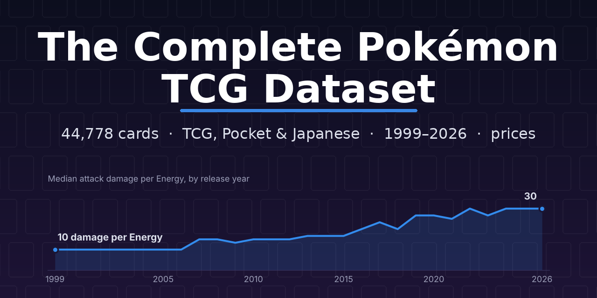

<center>
  
</center>

# The Complete Pokémon TCG Dataset

**44,778 Pokémon cards** as relational CSV tables and one SQLite database:
- **The international Trading Card Game:** 21,541 cards in 209 sets, from Base Set (January 1999) to Delta Reign (November 2026).
- **Pokémon TCG Pocket:** 4,577 cards in 27 sets, through Dual Fusion (October 2026), with pack pull rates.
- **Japanese and other Asian sets:** 18,660 cards in 346 sets.

Around the cards:
- **Text:** 54,868 attacks and 8,063 abilities, and card names in 14 languages.
- **Variants:** 47,807 printed variants (reverse holo, 1st edition, stamps) with their TCGplayer, Cardmarket and CardTrader ids.
- **Prices:** 488,808 monthly TCGplayer sale prices (November 2022 to September 2024).
- **Crosswalk:** an ID map back to pokemontcg.io.

It's the companion to **[The Complete Pokédex Dataset](https://github.com/cristobalmitchell/pokedex)**. `card_pokemon.csv` links each card to the National Pokédex numbers of the Pokémon on it, so card HP and attacks can be joined to game stats, types, forms and learnsets.

## Why version 2
Version 1 was a snapshot of pokemontcg.io (PokemonTCG/pokemon-tcg-data). That project is frozen, and its API goes offline on March 1, 2027.

Version 2 is rebuilt on **[TCGdex](https://github.com/tcgdex/cards-database)**, which is open source (MIT), actively maintained and much broader: Pocket, Asian sets, 14 languages, variants and marketplace ids.

Nothing from version 1 is lost: `cards.ptcgio_id` and `id_crosswalk.csv` map 20,664 of the 20,776 pokemontcg.io cards (99.5%) to their TCGdex ids. The rest have no TCGdex counterpart, such as Unown A–Z in Unseen Forces.

## Files

| File | Rows | One row per |
|---|---|---|
| `data/cards.csv` | 44,778 | card: region, game, stage, HP, types, evolution, weakness, resistance, retreat cost, rarity, artist, regulation mark, legality, pokemontcg.io id, image link |
| `data/card_names.csv` | 167,307 | (card, language) name in up to 14 languages |
| `data/card_attacks.csv` | 54,868 | attack: Energy cost, damage as printed (`30+`) and as a number with its modifier, effect text |
| `data/card_abilities.csv` | 8,063 | Ability, Poké-Power, Poké-Body, Pokémon Power or Ancient Trait |
| `data/card_pokemon.csv` | 33,507 | (card, National Pokédex number), featured or cameo |
| `data/card_variants.csv` | 47,807 | printed variant: finish, stamps, foil, TCGplayer / Cardmarket / CardTrader ids |
| `data/card_boosters.csv` | 4,786 | (card, booster pack it can be pulled from) |
| `data/id_crosswalk.csv` | 33,230 | card: TCGdex id ↔ pokemontcg.io ↔ TCGplayer ↔ Cardmarket ↔ CardTrader |
| `data/price_history.csv` | 488,808 | (card, finish, condition, month): TCGplayer average, min and max sale price and number of sales |
| `data/pocket_pull_rates.csv` | 1,145 | (Pocket set, pack type, slot, rarity): pull rate |
| `data/sets.csv` | 582 | set: series, region, game, size, release date, legality, marketplace ids, logo and symbol links |
| `data/set_names.csv` | 1,911 | (set, language) name |
| `data/decks.csv` | 188 | theme deck |
| `data/deck_cards.csv` | 3,976 | card line in a theme deck |
| `data/tcg.sqlite` | | every table, with primary and foreign keys (built by `build.py`; on Kaggle, not in git, because of its 79 MB size) |

The data dictionary, with a description of every column, is in [`dataset-metadata.json`](dataset-metadata.json).

```
sets (set_id) ─┬─< cards (card_id) ─┬─< card_names, card_attacks, card_abilities, card_variants, card_boosters
               │                    ├─< price_history
               │                    ├── id_crosswalk (ptcgio_id, tcgplayer / cardmarket / cardtrader ids)
               │                    └─< card_pokemon (national_number) >── Pokédex dataset: pokemon_utf8.csv
               ├─< set_names
               └─< pocket_pull_rates
decks (deck_id) ─< deck_cards (card_id) >── cards
```

## Build
```bash
bash scripts/fetch_sources.sh        # clones the sources into .cache/ (about 560 MB)
python scripts/build.py .cache       # data/*.csv and data/tcg.sqlite (about 30 seconds)
python scripts/build_metadata.py     # dataset-metadata.json for Kaggle
python scripts/validate.py           # integrity checks; run before every upload
python scripts/build_cover.py        # dataset-cover-image.png (needs Pillow and matplotlib)
python scripts/stage_kaggle.py       # kaggle_upload/: files and guide for Kaggle's web uploader
```

The build reads TCGdex's TypeScript card files directly with a small tokenizer, so it needs only Python and pandas, not Node.

To publish on Kaggle, follow `kaggle_upload/UPLOAD.md`. It lists the files to drag in, the title, subtitle, license, tags and cover, and how to add the starter notebook. `kaggle_upload/COLUMNS.md` has every column description ready to paste into the Data Card.

`validate.py` checks:
- **Keys:** unique ids, every foreign key, and the SQLite database against the CSVs.
- **Counts:** set sizes and attack and ability counts agree with the other tables.
- **Valid values:** types, Energy symbols, regulation marks, variant finishes, price conditions and months.
- **Prices:** the minimum never exceeds the maximum.
- **Pull rates:** each Pocket pack slot sums to 100%.
- **HP:** Pokémon cards have HP and Energy cards don't.
- **Legality:** set for exactly the international TCG cards.
- **Metadata:** it documents every column, in order.

## Starter notebook
[`notebooks/pokemon_tcg_eda.ipynb`](notebooks/pokemon_tcg_eda.ipynb) is an executed first analysis. It covers:
- **Power creep:** median HP doubled and median damage per Energy tripled, 1999–2026.
- **Rule-box cards:** their rise to 18–34% of Pokémon cards every year since 2015.
- **Cards vs. games:** card HP against each species' HP stat in the games (Spearman ρ = 0.74, via the Pokédex dataset).
- **Illustrators:** the most prolific artists.
- **Prices:** what each rarity sells for.
- **Pocket:** the pull-rate ladder, with a Crown Rare in 1 in 500 packs.

## Notes
- **Card ids** are TCGdex's, `<set_id>-<number>` (e.g. `sv03.5-199`). TCGdex ids are unique per language, so five Japanese sets that reuse an international id get an `-asia` suffix (`neo1-asia`).
- **Text language.** `text_language` gives the language of a card's name and text: English for every international card that has it (21,439 of 21,541), otherwise the card's own language, for example Japanese for Japanese sets. `card_names.csv` has the other languages.
- **The newest Pocket cards.** TCGdex trails the Pocket release schedule. The newest 12 Pocket sets (2,097 cards) come from the Pokémon TCG Pocket database and have no attack or ability text. Their `attack_count` is blank, and `source` = `pocket-database`.
- **Prices are historical.** TCGdex's TCGplayer price collector ran from November 2022 to September 2024. Prices are monthly aggregates of the daily sales it recorded, in US dollars.
- **Legality** follows TCGdex's rules at build time: Standard is regulation marks H–J; Expanded is Black & White onwards, minus the ban list. It's blank for Pocket and Asian cards.
- **Images.** Image links point at TCGdex's image host. They are set only where an image exists: 93% of international cards, 97% of Pocket cards and 31% of Asian cards.
- **Multi-valued cells** (types, Energy costs, stamps) are separated by `|`.

## Licenses
- **Code** (`scripts/`, `notebooks/`): MIT; see [`LICENSE`](LICENSE).
- **Dataset** (`data/`): custom non-commercial terms, which is the "Other" option on Kaggle. Use is limited to non-commercial research, education and analysis. Credit this dataset and TCGdex, and keep [`THIRD_PARTY_NOTICES.md`](THIRD_PARTY_NOTICES.md) with copies. The author's own contributions (table design, crosswalk, derived columns, corrections, documentation, cover) are reusable under [CC BY-NC-SA 4.0](https://creativecommons.org/licenses/by-nc-sa/4.0/). See [`DATA_LICENSE.md`](DATA_LICENSE.md).
- **Why not a standard license?** Card names, text and images belong to The Pokémon Company, so a standard license would claim rights this project doesn't hold.
- **No affiliation:** not affiliated with or endorsed by Nintendo, The Pokémon Company, Creatures Inc., GAME FREAK inc., TCGdex, TCGplayer or the PokemonTCG project. To request removal of material you hold rights in, [open an issue](https://github.com/cristobalmitchell/pokemon-tcg/issues).

## Sources and credits
- **Cards, sets, variants, marketplace ids and images:** [TCGdex](https://github.com/tcgdex/cards-database) (MIT).
- **Price history:** [TCGdex price-history](https://github.com/tcgdex/price-history) (MIT), from TCGplayer.
- **Pocket:** pull rates, packs and the newest sets come from the [Pokémon TCG Pocket database](https://github.com/flibustier/pokemon-tcg-pocket-database) (MIT).
- **pokemontcg.io ids and theme decks:** [PokemonTCG/pokemon-tcg-data](https://github.com/PokemonTCG/pokemon-tcg-data).
- **Rights:** card names, card text and card images are © 1995–2026 Nintendo, Creatures Inc. and GAME FREAK inc.
